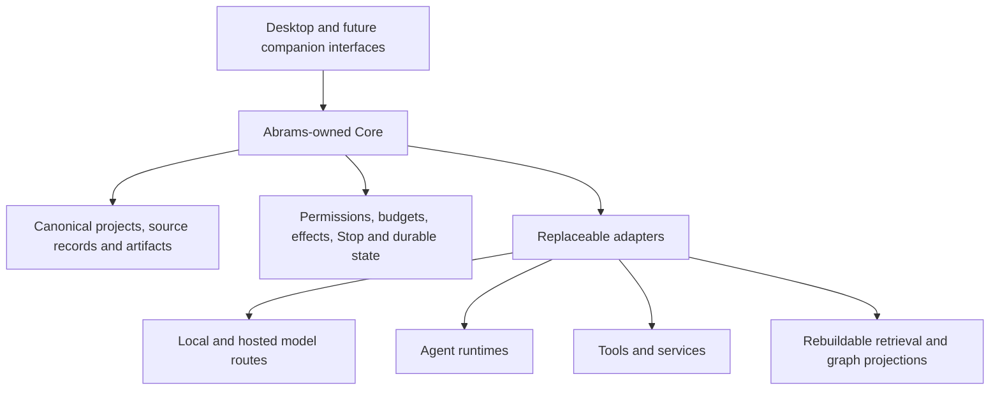

# Abrams Intelligence

I’m building a personal AI for my own everyday use, and learning how to build it along the way. The goal is a capable, local-first assistant for research, coding, creative projects, document work and everyday coordination that I can keep improving as the technology changes.

Models and components should be replaceable. I want to compare alternatives on tasks I actually need done, understand their trade-offs, and use different models where each works best. Projects, memory, source records and user controls should remain stable when a model, runtime or tool changes. Credentials, permissions, budgets and durable task state belong to the system’s own control layer.

Local execution is intended to make routine use independent of hosted-service message caps, within the limits of my hardware. Hosted models can remain optional, with explicit budgets. The aim is to build the best system I can for my needs through repeated testing and improvement; the full platform is still in development.

[Run the offline dispatcher](tools/dispatcher/README.md) · [Architecture explorer](https://theonetruedaniel.github.io/architecture/) · [Presentation](https://gamma.app/docs/for2zexybupmugn) · [Portfolio](https://theonetruedaniel.github.io/)

## What runs today

- **App source checks.** Six type-checks and nine test suites (197 tests) cover the Core, the desktop-shell renderer and the browser variant. They run with Node 24 and in CI. See [`app/`](app/README.md).
- **Offline developer dispatcher.** A five-scenario demo and its tests run with Python 3.13 and nothing else installed. See [Run the published component](#run-the-published-component).
- **Research catalog checks.** The catalog and documentation links validate offline. See [Check catalog and documentation changes](#check-catalog-and-documentation-changes).
- **Not yet here:** an installable assistant. [Current status](#current-status-november-14-2026) says what exists and what is still open.

## Repository layout

| Path | Contents |
| --- | --- |
| [`app/`](app/) | Product source: Core, Tauri shell, UI and synthetic fixtures. [What it includes and how to check it](app/README.md) |
| [`docs/`](docs/) | Architecture, design decisions, roadmap, progress and dated evidence |
| [`research/`](research/) | The repository catalog (Markdown and JSON) and the full candidate register |
| [`tools/dispatcher/`](tools/dispatcher/) | The offline developer dispatcher: source, tests and demo |
| [`examples/`](examples/) | Illustrative JSON records used by the walkthroughs |
| [`scripts/`](scripts/), [`tests/`](tests/) | The catalog and link validator and its tests |

## Exploratory browser demo — October 27, 2026

An exploratory browser demo provides a local interface for saved conversations and document/image attachments. It was an off-plan side experiment, not the planned Abrams Intelligence prototype or the platform's final result. Qwen3.5 4B passed bounded local text, document and image checks and was the initial available model; the downloaded 9B build was unavailable on the tested PC because measured memory headroom was insufficient. The demo's recorded local build and fixture checks passed; live ChatGPT-plan access remained unverified. These demo results do not qualify product Core or runtime behavior, or complete Phase 2. The broader platform's integration and acceptance work continues. [Demo scope and historical measurements](docs/prototype.md).

## Explore the research

The [research catalog](research/repository-catalog.md) maps **208 upstream GitHub repositories** to roles in a local-first assistant. Each entry records its purpose, sources, architecture fit, evaluation status and next gate. Use the [interactive catalog](https://theonetruedaniel.github.io/architecture/#repository-catalog) to explore the collection, or read the [comparison method](docs/evaluation-method.md).

Comparisons are organized by role: agent runtimes against runtimes, retrieval approaches against retrieval approaches, and desktop shells against shells. Most candidates have source research or planned evaluations; they have not been benchmarked or adopted. The [results and evidence](docs/results-and-evidence.md) page separates measured findings from unrun comparisons. The catalog and offline dispatcher are available now while the full platform remains in development.

## Current status: November 14, 2026

**Stage: early build.** There is no assistant to install or use yet. The work is in Phase 2 of the plan, which has one job: choose the desktop shell, either a Tauri app or a local web app (PWA).

### What exists

- **Core** (TypeScript): handles the version 1 messages (health, start a run, stream events, cancel, stop everything, reconnect), with an in-memory version and a SQLite-backed store. [`app/core/`](app/core/)
- **Desktop shell** (Rust and Tauri): builds to a Windows executable. [`app/shell/`](app/shell/)
- **Interface**: one renderer for the Tauri window and one browser variant. [`app/ui/`](app/ui/)
- **Developer dispatcher**: a separate offline tool, not part of the product. [`tools/dispatcher/`](tools/dispatcher/)
- **Research catalog**: 206 upstream repositories mapped to roles. None has been adopted. [`research/`](research/)

### What has been tested

- **In this repository, on every change:** 197 source-level tests in nine suites, plus six type-checks. They use fake DOM objects and an in-memory Core; they do not launch the app.
- **On the development machine, with real processes:** the Rust shell talking to the Node Core over pipes (15 tests, including five failure cases); the Core bundle found correctly from two install locations (21 tests each); shell startup ordering (28 tests); and twelve separate crash, replay, reload and capacity checks of the store. Each has a dated record and a separate review. These cannot be re-run from this repository. [Evidence](docs/evidence/phase-2/) · [Progress ledger](docs/progress.md)
- **Once, by eye:** the Tauri executable opened and closed cleanly with the Core disconnected.

### What is not done

- The shell has not run connected to the Core in a window, and the Tauri and browser versions have not been compared side by side. No shell has been chosen.
- Two disk-fault tests of the store (a partial write and an uncertain flush, "RC07") have not run. Their test build is blocked.
- Launch time, memory, responsiveness, accessibility, tray behavior and packaging have not been measured.
- The native build has not been repeated from the published source layout.

### What is next

A November 14 amendment narrowed Phase 2 to the shell decision and moved the two RC07 tests, the timing measurements and the packaging work to later milestones, where they stay recorded as not done. Phase 2 now ends when five things are complete:

1. A witnessed Tauri run with the Core connected: start, output, cancel and stop.
2. The same flows in a real browser for the PWA.
3. The message and denial checks passing on both.
4. A manual keyboard, focus and zoom check on both.
5. A review of those results, then the shell decision.

When that happens Phase 2 will be closed with recorded deferrals, not passed as originally written. [Roadmap](docs/roadmap.md) · [Results and exclusions](docs/results-and-evidence.md) · [Changelog](CHANGELOG.md)

## Run the published component

With Python 3.13 or later, from the repository root:

```powershell
cd tools/dispatcher
python -m scripts.dispatch.demo
python -m unittest discover -s tests/dispatch -p test_demo.py -v
```

The five-scenario demo checks routine routing, consequential review, return to a routine route, an explicit Manual choice and a blocked unavailable Manual route. Expected output is `5/5 checks passed`. These are offline previews using synthetic tasks and a synthetic catalog: every preview reports `dispatched: false`, no model executes a task, and real account usage remains unknown. No package installation, account, API key, model download or WSL session is needed for these two commands. These Codex development presets do not restrict the provider-neutral product design.

October 4 verification for this published source package: **227 tests passed, 23 skipped, zero failures/errors** in the full default dispatcher suite, with the five demo scenarios and three focused demo tests also passing. The 23 skips cover nine Linux-only transport tests, twelve opt-in containment tests and two unavailable symlink-privilege cases. This is dispatcher coverage, not full-platform acceptance or current-build live containment evidence. The October 1 result of 88 selected tests and four preview checks remains separate historical evidence.

[Component walkthrough](docs/development-dispatcher.md) · [Recorded output](tools/dispatcher/demo-transcript.txt) · [Verification scope](tools/dispatcher/VERIFICATION.md) · [Evaluation matrix](tools/dispatcher/EVALUATION.md)

## A quick reading path

1. Open the [architecture explorer](https://theonetruedaniel.github.io/architecture/) to inspect the intended control flow. It uses mock components and fictional data.
2. Follow the [research task walkthrough](docs/research-workflow-walkthrough.md) to see scope, sources, Stop and ambiguous-outcome handling as a design scenario.
3. Browse the [208-repository catalog](research/repository-catalog.md) for verified links, purposes, architecture fit and current evaluation states. The [full register](research/candidate-research.md) accounts for 311 entries, including routes, controls and prerequisites.
4. Inspect the [evaluation method](docs/evaluation-method.md) and [results](docs/results-and-evidence.md) to separate measured evidence from acceptance plans.

The repository now contains product source with source-level tests and runnable development tooling, alongside architecture documents and illustrative JSON. It does not yet contain an installable personal-assistant product. The architecture explorer remains a separately hosted simulation.

## Design decisions



**Keep authority in one place.** A runtime can propose work; Core must own grants, exact routes, credentials, effect receipts and recovery. This adds adapter work, but makes a runtime replacement less likely to change what a task is allowed to do.

**Start with the simpler memory control.** Canonical SQLite records and relational/full-text retrieval come before optional vector or graph projections. Richer retrieval must show a measurable benefit and preserve source revisions, deletion and rebuild behavior.

**Compare by role.** Tauri versus local web/PWA tests the shell. Runtime conformance is separate from model quality. Workflow ideas, reusable components and whole-product adaptation are separate studies. A popular upstream repository is not automatically an approved dependency.

**Treat uncertainty as a state.** Requesting cancellation is different from confirming it. A timeout after an external effect needs reconciliation before another attempt. The public walkthrough explains this rule; it does not claim a product recovery test has run.

## What the research currently says

The register accounts for 150 original discovery entries and 161 later proposed entries, including internal controls and prerequisites. Most external candidates have source research or plans, not benchmark results. No production runtime/model pairing has been adopted.

One measured trade-off is the Laya development selector: its speed did not compensate for failed quality and memory thresholds. The existing deterministic rules remain the fallback. The published dispatcher tests demonstrate offline routing and lifecycle invariants with synthetic transports. They do not establish model quality, live editing or monetary savings.

## Next work and gates

Product next steps are listed under [Current status](#current-status-november-14-2026). For the developer dispatcher, live editing remains off: passing synthetic tests does not enable it, and qualification against the current build is unresolved. No production runtime or model pairing has been selected. [Roadmap and gates](docs/roadmap.md) · [Desktop-shell comparison](docs/desktop-shell-decision.md)

## Engineering documents

| Document | What to look for |
| --- | --- |
| [Architecture](docs/architecture.md) and [deep dive](docs/architecture-deep-dive.md) | Ownership boundaries and source-data lifecycle |
| [Design decisions](docs/design-decisions.md) | Local data, selection and execution trade-offs |
| [Desktop-shell study](docs/desktop-shell-decision.md) | Preregistered Tauri/PWA comparison; no winner yet |
| [Candidate research](research/candidate-research.md) | Full inventory, source credits, intended roles and exclusions |
| [Evaluation method](docs/evaluation-method.md) | Controls, frozen tasks, metrics and decision rules |
| [Results and evidence](docs/results-and-evidence.md) | Actual selected tests, Laya results and unrun checks |
| [Acceptance map](docs/acceptance-evidence-map.md) | Illustrative requirements and future proof obligations |
| [Roadmap](docs/roadmap.md) | Current phase and capability-specific gates |
| [Source notes](docs/source-notes.md) | Dates, provenance and public/private evidence boundary |
| [Reviewer guide](docs/reviewer-guide.md) | Questions to use when inspecting the design |

## My contribution and feedback

I define the requirements, prioritize capabilities, evaluate integration choices and review the design against practical workflows. I use AI assistance for research, documentation, prototyping and code development. Upstream authors retain credit for their projects; this repository does not imply affiliation or an installed integration.

Source-backed corrections, reproducible offline-tooling bugs and architecture questions are welcome through [issues](https://github.com/theonetruedaniel/abrams-intelligence/issues). See [contribution guidance](CONTRIBUTING.md) and [changelog](CHANGELOG.md). Publication of development-tool source does not admit live execution.

### Check catalog and documentation changes

With Python 3.13 or later, run from the repository root:

```powershell
python -m unittest discover -s tests -p test_catalog.py -v
python scripts/validate_catalog.py
```

These checks validate catalog consistency and local file links in root, `docs/`, `research/` and `.github/` Markdown. They do not check remote availability, heading fragments or research correctness, and they do not run candidate software. The same checks run in the catalog and documentation CI workflow.

## License

Abrams-authored source and documentation are available under the [MIT License](LICENSE). Upstream projects, dependencies, model weights and hosted services retain their own licenses and terms; see the [third-party scope note](THIRD_PARTY.md). Catalog references are not adoption or license-clearance decisions.

**Daniel Abrams** · [LinkedIn](https://www.linkedin.com/in/danielmabrams/) · [GitHub](https://github.com/theonetruedaniel)
